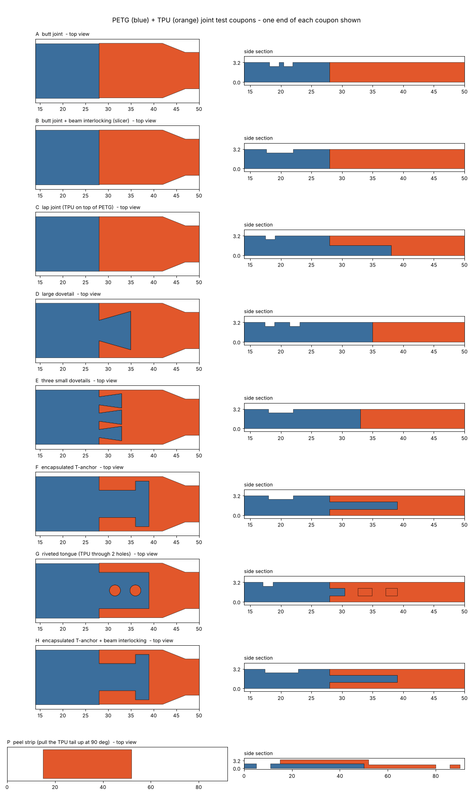

# PETG + TPU joint tests

PETG and TPU often bond poorly to each other. Before building anything that
loads the joint between them, such as a rover chassis with TPU suspension,
this plate measures how strong each kind of joint is on **your** printer, with
**your** filaments and settings.

| Coupon | Joint | What it shows |
|---|---|---|
| **A** | Butt joint: flat faces side by side in each layer | Baseline. Plain contact between the two materials |
| **B** | A + Bambu Studio *beam interlocking* | What the slicer's interlocking adds to a plain joint |
| **C** | Lap joint: TPU printed on top of a PETG tongue | Bond between stacked layers, loaded in shear |
| **D** | One large dovetail | Mechanical lock in the plane of the layers |
| **E** | Three small dovetails | Same, finer |
| **F** | Encapsulated T-anchor: a thin PETG tongue wrapped in TPU on all sides | Overmould-style capture |
| **G** | Riveted tongue: TPU wraps a PETG tongue and fills two holes through it | TPU "rivets" through the PETG |
| **H** | F + beam interlocking | The best combination |
| **P** | Peel strip: TPU printed on a PETG plate | Peel, the worst case for any bonded joint |

There are two of each, 18 coupons in all, on one plate. They are only 3.2 mm
thick, so the print is short; Bambu Studio shows the exact time.

## Printing

Print with the **same filaments and settings you plan to use** for the real
part. Otherwise the test tells you about a different joint.

- **Bambu Studio:** start with an empty plate and open
  `print/bond_tests_BambuStudio_H2D.3mf` (File > Open, or drag it onto the
  plate). Every coupon is its own object, with the PETG part on filament 1 and
  the TPU part on filament 2.
  - B1, B2, H1 and H2 already have *Use beam interlocking* switched on, with
    *Interlocking direction* 45, *Interlocking depth* 3 and *Interlocking
    boundary avoidance* 0. Their rows in the Objects list show a settings
    icon.
  - If you add the file to a plate that already has objects, choose **Open as
    project**. *Import geometry only* drops those object settings.
  - To switch interlocking on by hand: right-click the object > *Add
    settings* > *Others* > tick *Use beam interlocking*, then set the three
    values above.
- **STLs instead:** select `print/bond_tests_PETG.stl` and `print/bond_tests_TPU.stl`
  together, import them in one go and answer **Yes** to *"Load these files as
  a single object with multiple parts?"*. Then set the TPU part to filament 2.
  This route has no per-coupon interlocking, so B and H print the same as A
  and F.
- Filaments: PETG on filament 1 (left nozzle), TPU 95A on filament 2 (right
  nozzle, external spool). Filament grouping: Custom, PETG left, TPU right.
- Layer height 0.2 mm. The coupons are 16 layers thick.

Why boundary avoidance is set to 0: Bambu Studio keeps the interlocking beams
a number of grid cells away from every outer surface, in all three
directions. This was measured by running Bambu Studio's own slicing code. At
the default of 2:
- joints narrower than about 6 mm or shorter than about 2.4 mm get no beams;
- these 3.2 mm thick coupons would get beams in only 8 of their 16 layers;
- the outer 1 to 2.5 mm rim of every joint is never interlocked, and that rim
  is exactly where a peel starts.

## Testing

You need a luggage scale with a peak-hold reading (or a bucket you can fill
with water and weigh), a solid hook, and a pen.

1. **Pull test (A to H).** Hook one grip hole over something solid. Hook the
   luggage scale into the other grip hole and pull slowly and steadily along
   the coupon. Stop when a joint lets go, or when the TPU strap has stretched
   to about twice its length (then the joint is stronger than the TPU: write
   *"> TPU"*). Write down the peak reading and which end failed.
2. **Peel test (P).** Clamp or hold the PETG plate flat, hook the scale into
   the TPU tail and pull it straight up at 90 degrees, slowly. Note the steady
   reading while it peels, and whether it peels at all or the tail stretches.
3. **Flex test (any coupon that passed).** Hold one grip and bend the TPU
   strap back and forth through about 90 degrees, 200 times. Look at the
   joint closely for any gap opening, then pull-test it again. This is the
   test that matters most for a suspension, which flexes all day.

Record the results like this:

| Coupon | Peak pull (kg) | What failed | After 200 flexes |
|---|---|---|---|
| A1 / A2 | | | |
| B1 / B2 | | | |
| ... | | | |

The strap is 8 x 3.2 mm. A reading in kg times 9.81 / 25.6 gives the stress in
the TPU in MPa.

## Files
- `coupons.scad`: the coupon geometry (OpenSCAD). `type` and `part` pick one coupon.
- `build.py`: builds the plate (`python3 bond_tests/build.py`) and checks every mesh.
- `print/`: the 3MF, the two STLs and `build_report.json`.
