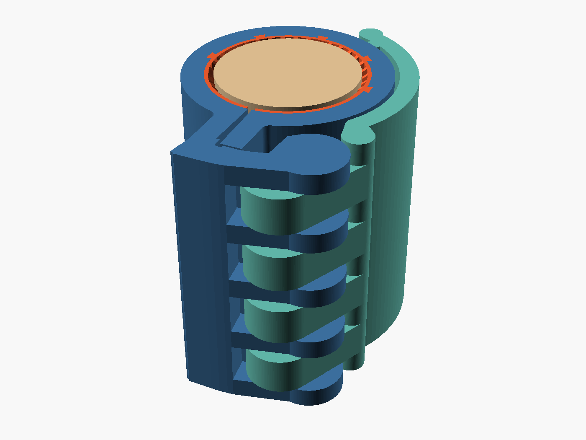
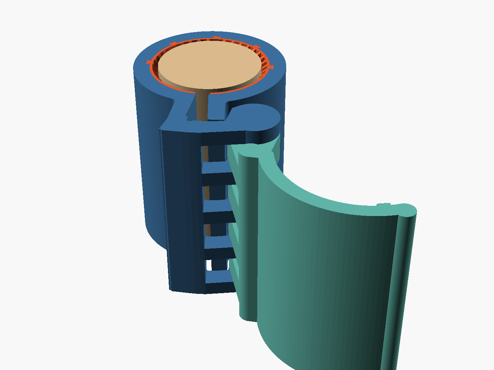
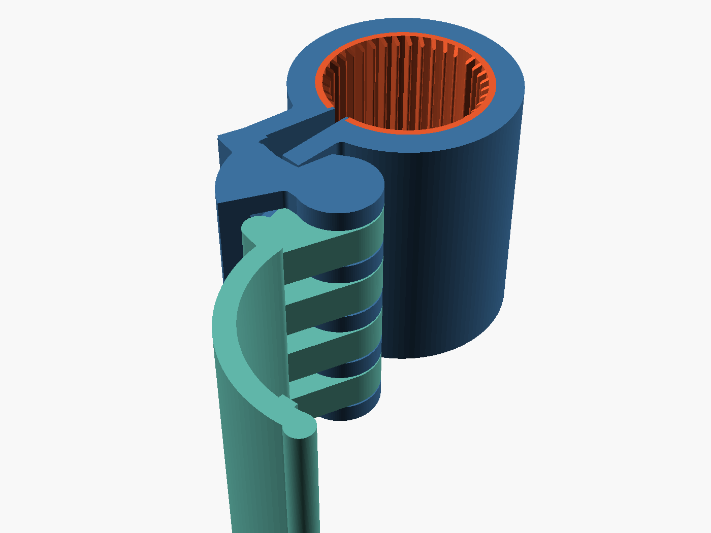
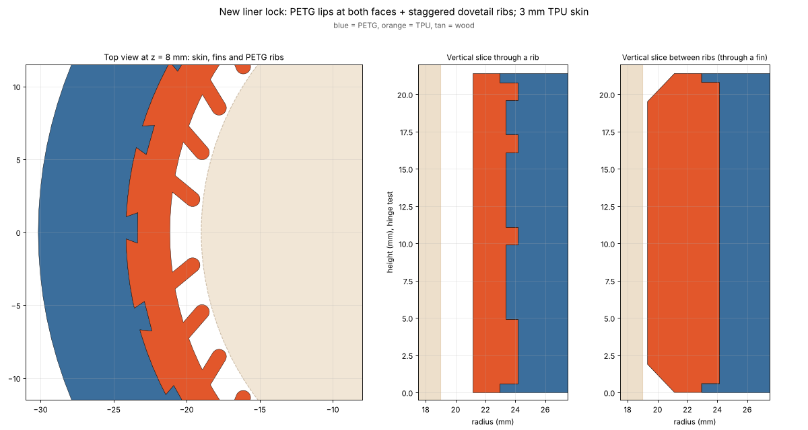

# Screwless cam-lever clamp for a cracked wooden cylinder

A clamp for a wooden cylinder (38 mm diameter, 70 mm tall) that holds an
axial crack closed and stops it running further. It is **one print with no
screws, pins or other parts**: a PETG collar with a TPU spring lining and a
PETG lever whose hinge is printed already assembled.

| Closed on the wood | Open (slides on and off) | As printed |
|---|---|---|
|  |  |  |

Motion videos: [3D view](images/motion_3d.mp4), [top view](images/motion_top.mp4).

## How it works

- The **collar** is a C shape with a slit. It is printed slightly open, so it
  slides over the end of the wood with about 0.25 mm of clearance.
- The **lever** turns on an 8 mm pin that is part of the collar. Its four cam
  rings sit between fixed knuckles, so it cannot come off
  ([slice through the hinge](images/hinge_slice.png)).
- Pushing the lever down makes its off-centre cam press the ear beside the
  slit. The slit closes, the collar shrinks, and the **TPU fins** squeeze the
  wood. The fins are springs, so the grip stays steady as the wood swells and
  shrinks with humidity.
- In the last 10° of travel the cam passes dead centre. From there the load
  holds the lever shut, so it cannot spring open.
- **The TPU lining is locked in by shape, not glue.** PETG and TPU do not
  reliably stick to each other (the first hinge test showed it), so:
  - PETG **lips** run over the lining at the top and bottom faces;
  - PETG **dovetail ribs** every 15° reach into the 3 mm TPU skin. They are
    broken along the height and staggered, so TPU wraps round and between them;
  - PETG **end walls** cover both ends of the lining at the slit;
  - Bambu Studio's **beam interlocking** weaves the PETG and TPU together
    along the whole joint. The 3MF switches it on for you.

  

## Files (`print/`)

Each print is **two STL files, one per material**: they are the two parts of
one object and have to be loaded together (see the next section).

| File | What it is |
|---|---|
| `hinge_test_PETG.stl` + `hinge_test_TPU.stl` | A 21 mm tall working slice of the clamp (one cam ring). **Print this first.** |
| `wood_clamp_PETG.stl` + `wood_clamp_TPU.stl` | The full clamp. PETG = collar and lever; TPU = the spring lining |
| `*_BambuStudio_H2D.3mf` | The same, as one 3MF (also has a support blocker over the hinge). See the notes below |
| `*_PrusaSlicer.3mf` | The same, for PrusaSlicer (Bambu Studio reads it correctly too) |
| `build_report.json` | Mesh checks and slice test for the files above |

All files are for **38.0 mm wood**. If yours measures differently, see
"Your wood diameter" below.

## Loading the STLs in Bambu Studio

1. **Two filaments first.** In the Filament list on the left, make sure there
   are two: **1 = PETG**, **2 = TPU 95A** (use the + button to add one). With
   only one filament, Bambu Studio hides the menu used in step 4.
2. **Import both STLs in one go.** File > Import > *Import 3MF/STL/STEP/SVG/OBJ/AMF*
   (Ctrl+I), select **both** `wood_clamp_PETG.stl` and `wood_clamp_TPU.stl`
   (Ctrl-click or Cmd-click) and open them. Dragging both files onto the plate
   in a single drop works too. Do not include the 3MF in the selection.
3. Bambu Studio asks **"Load these files as a single object with multiple
   parts?"** Click **Yes**. This keeps the lining exactly inside the collar.
   (If you click No, or load the files one at a time, the lining lands in the
   wrong place. Delete everything and repeat step 2.)
4. In the Objects list, open the object. It has two parts, `wood_clamp_PETG.stl`
   and `wood_clamp_TPU.stl`. Right-click **`wood_clamp_TPU.stl`** > **Change
   Filament** > filament **2** (TPU). Afterwards, do not change the filament on
   the object row, because that resets both parts to one filament.
5. **Nozzles.** Click the plate's *Edit filament grouping* icon (in the row of
   small icons on the plate), choose **Custom**, and put PETG on the **left**
   nozzle and TPU on the **right**.
6. **Beam interlocking** (the STLs cannot carry it): right-click the object >
   *Edit Process Settings*. The process panel now shows this object's own
   settings. Turn on the *Advanced* switch at the top of the panel, open the
   *Others* tab, tick *Use beam interlocking*, and set *Interlocking beam
   width* **0.6 mm** and *Interlocking depth* **1**. Leave the other
   interlocking values at their defaults: beam layers 2, boundary avoidance 2,
   direction 22.5°. See "Why these interlocking values" below.
7. Apply the settings below and slice. In the sliced Preview, the joint
   between the lining and the collar should show a fine woven pattern.

**Using the 3MF instead:** it loads as one object with the parts already on
filaments 1 and 2, and the beam interlocking values already set on the object.
- When you open it, Bambu Studio shows *"The 3mf is not from Bambu Lab, load
  geometry data and color data only."* That message is normal and nothing is
  missing.
- Do step 1 **before** opening it, or the TPU part silently prints in
  filament 1.
- Open it on an empty plate, or choose *Open as project*. *Import geometry
  only* drops the interlocking settings.
- Then do step 5.

**Why these interlocking values.** The slicer replaces a band along the joint
with a woven pattern, half PETG and half TPU. At the default 0.8 mm beam width
that band reaches about 2–3 mm into the TPU. Here that would put PETG into
the roots of the spring fins, which must stay pure TPU.

With 0.6 mm beams at depth 1, measured by running Bambu Studio's own slicing
code on the hinge test:
- the woven band appears on 96 of the 107 layers;
- it stays at least 0.65 mm clear of the fin roots;
- it reaches 1.7 mm into the PETG collar.

The faces are left out of the woven band, and the PETG lips hold the TPU
there.

## Printing on a Bambu Lab H2D

### Filaments and nozzles
- **Filament 1: PETG** (for example Bambu PETG HF or PETG Basic), **left nozzle**. It can feed from the AMS.
- **Filament 2: TPU 95A** (for example Bambu TPU 95A HF), **right nozzle**,
  from the external spool through the TPU bypass, **not through the AMS**.
  On the H2D, TPU only prints from the right nozzle.
- Bambu's harder "TPU for AMS" (68D) is much stiffer. The fins are sized for 95A.
- Filament grouping: **Custom**, PETG left, TPU right (step 5 above).

### Recommended settings (best balance of time and quality)
Start from the **0.20mm Standard @BBL H2D** process and change only these:

| Setting | Value | Why |
|---|---|---|
| Layer height | **0.20 mm, do not change** | The hinge gaps are exactly 3 empty 0.2 mm layers |
| First layer height | 0.20 mm | Same reason |
| Wall loops | **4** | Makes the pin, cam rings and hinge web almost solid (3 loops saves only about 7 % of the time) |
| Top / bottom shells | 5 / 4 | |
| Sparse infill | 20 % gyroid | The strength comes from the walls. 25 % adds about 5 % to the time, 40 % about 20 %, for little gain |
| **Supports** | **OFF** | Supports would fill the hinge gaps. Ignore the "floating / long bridge, consider supports" warning: those bridges are intended. (The 3MF also has a support blocker over the hinge; the STLs do not, so with STLs supports must stay off) |
| Thick bridges | **OFF** | Thick bridges eat into the 0.6 mm hinge gaps |
| Bridge / overhang fan | 100 % | Clean first layers over the hinge gaps |
| Seam | Aligned | |
| Outer wall speed | 150 mm/s (PETG) | Truer pin and cam surfaces; leave other speeds at the profile defaults |
| Brim | Outer brim only, 3 mm | Steadies the tall handle; at the bed the lever is 7 mm from the collar, so the brims cannot join |
| Elephant foot compensation | default (0.15 mm) | |
| Prime tower | ON (default); drag it to a plate corner away from the hinge and handle | Needed for the nozzle change |
| Use beam interlocking | ON, beam width 0.6 mm, depth 1 (already set in the 3MF) | Weaves the TPU lining into the collar; see "Why these interlocking values" |
| Plate | Textured PEI, no glue | |
| Temperatures | filament profile defaults, bed 70 °C | |

Where the time goes: mostly the thick walls, plus one nozzle change per
layer (about 350 of them), because the TPU lining runs the full height. To
print a bit faster, drop infill to 15 % (about 8 % less time) and keep
everything else. To get a smoother finish, take the outer wall speed down to
about 100 mm/s. **Do not change the layer height** unless you rebuild the
files with the matching `layer_h` (see Customising). Printed at a different
layer height, these files lose their exact 3-empty-layer hinge gaps.

Bambu Studio shows the exact print time. With these settings the full clamp
uses about 130 g of PETG (plus the prime tower) and about 20 g of TPU. The
hinge test uses about a third of that.

### After printing
1. Let it cool on the plate, then remove it.
2. **Free the hinge:** hold the collar and work the lever back and forth a few
   times. The layers over the hinge gaps may be lightly stuck at first. They
   should come free with steady thumb pressure; if needed, run a thin blade
   along the gaps.
3. With the **hinge test** check four things:
   - the lever swings freely;
   - it pushes over its last 10° and stays shut;
   - it holds the wood;
   - the TPU lining stays put. Try to lift its edge with a fingernail at the
     slit and at the faces; it should not come away anywhere.

   If the hinge is fused, rebuild with `xy_gap` 0.55 and `z_gap_layers` 4. If
   it feels loose, use `xy_gap` 0.35.

## Fitting it to the wood
1. For a proper repair, first work wood glue (PVA) or thin epoxy into the crack.
2. Open the lever and slide the collar over the end of the wood. Turn it so
   **the slit is close to the crack**: the squeeze is strongest within about
   45° of the slit.
3. Push the handle down until it stops against the collar. It is now locked.
   Expect about 30 N at the handle tip at the stiffest point (a firm thumb or
   palm push). Depending on the TPU and the wood it can be 20–40 N.
4. To remove it, lift the handle tip (about 25 N) and slide the collar off.

## Your wood diameter
1. Measure the cylinder with calipers at three heights, twice at each height
   (turned 90°), so six readings in total.
2. Build with the **average**:

   ```
   python3 tools/build_print.py -D wood_d=37.8
   ```

3. Check the readings against that average:
   - the largest reading is no more than **0.30 mm** above it (otherwise the
     collar will not slide on);
   - largest minus smallest is no more than **0.6 mm** (otherwise the wood is
     too out of round for an even grip).

One print fits wood from about **0.33 mm under to 0.30 mm over** the
diameter it was built for. Inside that range the pressure on the wood varies
by about ±30 %.

**Check the print, not just the wood.** On the hinge test, with the lever
open, measure the inside diameter across the TPU fin tips (light touch with
the caliper jaws). It should be **38.44 mm** for a 38.0 mm build (wood
diameter + 0.44). If it comes out larger by some amount, rebuild with
`wood_d` smaller by that amount, and the other way round.

## What was checked (simulation, not yet a real print)
- **Motion:** the lever was swept from open to closed. At each step the collar
  closes exactly as far as the cam pushes it, and collisions were checked in
  2D (`tools/kinematics.py`) and in full 3D on the print meshes
  (`tools/sweep3d.py`). There are no collisions. As printed, the narrowest
  gaps are 0.45 mm (around the pin), 0.6 mm (between layers), 0.6 mm (ear to
  knuckle) and 0.9 mm (cam ring to collar). The lever locks 10° past dead
  centre.
- **Forces:** squeeze, cam force and hand force through the whole travel
  (`tools/forces.py`, rigid-part model; `tools/collar_fea.py` adds the
  flexing of the PETG parts, which takes the hand force down to about 30 N).
- **Stress:** 3D finite-element analysis with CalculiX, on the parts rebuilt
  as exact solids (`tools/brep.py`, `tools/fea.py`, `tools/stress_check.py`).
  The solver was validated on a beam against textbook values. PETG is about
  45 MPa in tension, and the bond between layers is weaker, so stress
  *across the layers* was kept to about 10 MPa or less.

  | Closed collar, fins modelled as springs | typical TPU | stiff TPU |
  |---|---|---|
  | Cam force | 213 N | 277 N |
  | Squeeze on the wood, min / average / max | 0.23 / 0.31 / 0.53 mm | 0.18 / 0.27 / 0.55 mm |
  | Average pressure on the wood | 0.22 MPa | 0.31 MPa |
  | Stress, 99.5 % of the part below / highest | 8.7 / 16.0 MPa | 11.3 / 20.7 MPa |
  | Across the layers, highest / at the pin | 7.8 / 4.6 MPa | 10.2 / 5.9 MPa |

  The highest stress across the layers is in the sharp inside corner where the
  ear the cam presses meets the outside of the ring; 0.5 mm away it is already
  below 6 MPa. Even if the fins jammed solid (about 430 N on the cam), the
  stress across the layers stays near 9 MPa at the pin and 16 MPa in that
  corner. The FEA model leaves out the small lining-lock features (lips, ribs,
  end walls); they only add material on the inside of the bore.

  The lever was checked with the worst-case loads from the rigid model (stiff
  TPU, wood 0.4 mm oversize: about 590 N on the cam and 64 N on the handle,
  roughly twice the realistic values). Closed, its highest stress is 11.1 MPa
  (4.2 MPa across the layers). While it is being pushed, 99.5 % of it is below
  11.7 MPa, and the middle of the handle stays below about 16 MPa. The model
  shows spikes in two places:
  - the sharp inside corners where each cam ring meets the handle neck (up to
    62 MPa on the corner itself). A linear model always reads very high at a
    sharp corner; 0.5 mm away the stress is below about 36 MPa (17 MPa across
    the layers), at twice the realistic load;
  - the small patch where the model puts the hand force on the handle tip.
    That is a modelling artefact: the real bending there is almost zero.

  Two changes came out of these checks: the hinge pin went from 6 to 8 mm
  with small fillets where it meets each knuckle, and in the knuckle layers
  the knuckle is filled out to the end of the arm, which removed a sharp notch.
- **Lining lock:** with zero adhesion assumed, the TPU lining cannot slide
  out of the collar in any of 26 directions; it is stopped within 0.15 mm
  (`../hybrid_lib/tools/capture_check.py`). The first design's lining, the one
  in the hinge test that was printed, was free to slide straight up or down,
  held only by adhesion. The test treats both parts as rigid, so it is a
  necessary condition, not a proof: soft TPU can still be pulled out by
  bending it a lot. The fingernail check on the new hinge test (above) is the
  real test.
- **Beam interlocking:** checked by slicing the hinge test with Bambu Studio's
  own slicing code. The woven band appears on 96 of 107 layers and stays at
  least 0.65 mm clear of the fin roots.
- **Print files:** watertight meshes, exactly one collar, one lever and one
  liner, no PETG/TPU overlap. They slice with two extruders in PrusaSlicer.
  They were also loaded with Bambu Studio's own loading code (version
  02.08.04, built without its GUI; see `tools/bambu_load/`):
  - Every 3MF loads as one object, with PETG on filament 1, TPU on filament 2
    and the hinge support blocker, at the same plate position.
  - Importing the two STLs together and answering Yes keeps the lining
    exactly in place. Both parts then start on filament 1, which is why step
    4 above is needed.
- **Not yet done:** a real print. Print the hinge test first.

## Customising
Every dimension is a parameter in `clamp.scad`: wood diameter, clamp height,
squeeze, fit gap, fin shape, wall, cam and handle sizes, and the
print-in-place gaps (`xy_gap`, `z_gap_layers`, `layer_h`). `tools/` has the
build, check and simulation scripts:

```
python3 tools/build_print.py [-D name=value ...]      # print files + checks
tools/export_checks.sh && python3 tools/kinematics.py build/chk 10.8 2.75 && python3 tools/sweep3d.py build/chk
python3 tools/forces.py build/chk                     # force simulation
python3 tools/collar_fea.py build/chk 4.0             # collar FEA, fins as springs
python3 tools/animate.py build images/motion_3d.mp4   # motion video
```

Requirements: OpenSCAD 2021+, Python 3 with trimesh, manifold3d, shapely,
numpy, scipy, gmsh, tetgen, matplotlib and Pillow; CalculiX (`ccx`);
PrusaSlicer (optional slice test); ffmpeg (videos).
